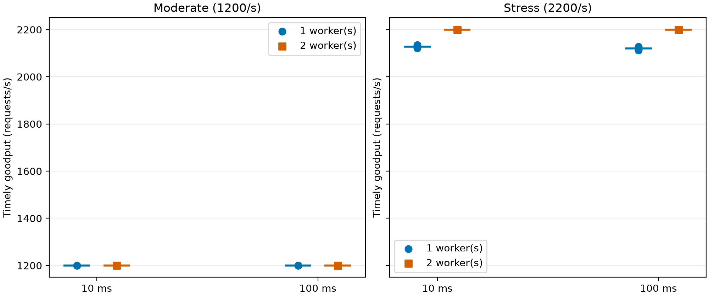
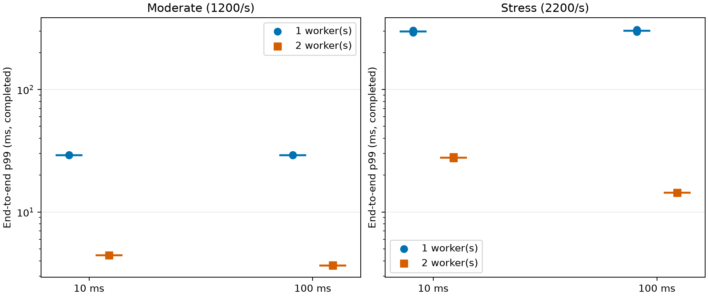
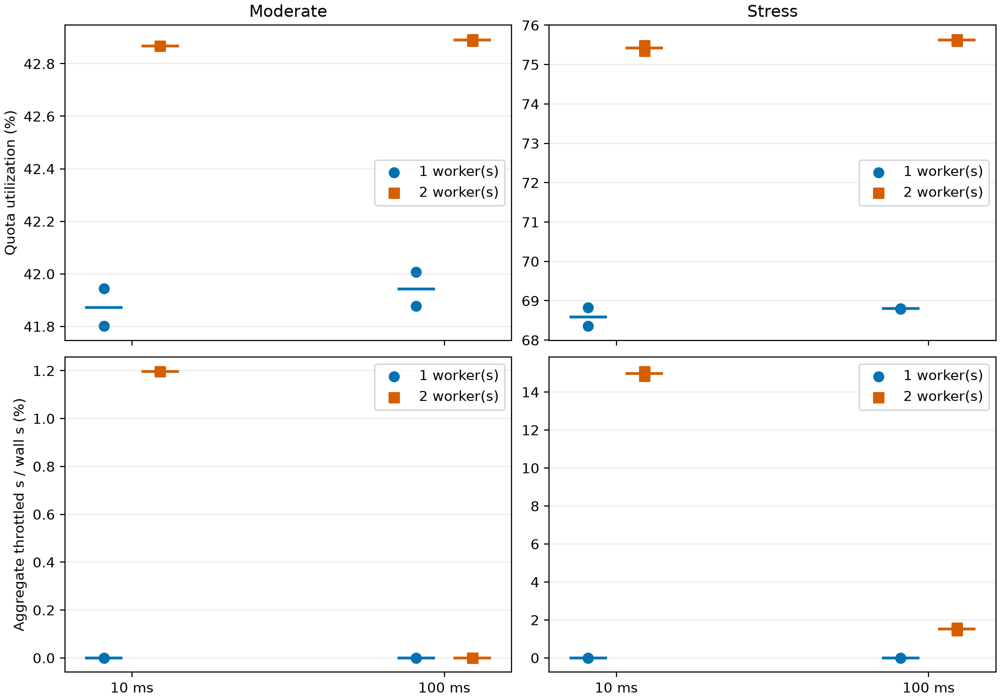
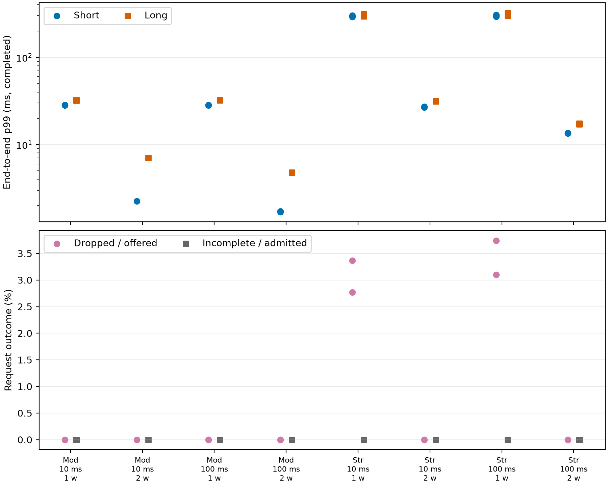

# CPUQuotaLab

CPUQuotaLab is an independent undergraduate systems-research project studying a practical ambiguity: a Linux CPU quota may allow fractional average CPU time, but a native thread pool must contain an integer number of workers. At a 1.5-CPU quota, one worker cannot use the fractional half CPU concurrently; two workers can, but may exhaust bandwidth and be throttled.

This repository contains a Rust experimental instrument, a predeclared 140-cell design, 317 exploratory pilot attempts, and a preliminary confirmatory subset with 15 valid runs. The work is preliminary, single-machine, and not peer reviewed.

The public repository contains code, protocols, derived tables, figures, provenance metadata, and the preliminary paper. The 1.74 GB raw confirmatory dataset is deliberately excluded from Git and must be archived separately after privacy-preserving export and researcher approval.

## Research question

How do fractional CPU quotas and CPU-bandwidth replenishment periods interact with native worker-pool sizing to affect end-to-end tail latency, throughput, and resource efficiency under mixed-duration CPU-bound workloads?

The current confirmatory subset compares one versus two workers, 10 versus 100 ms periods, and 1,200 versus 2,200 requests/s at a 1.5-CPU quota. Uniform work, eight workers, and the conceptual two-CPU anchor remain planned but uncollected.

## Architecture

```text
Generator on E-cores 8-11                 Server on P-core CPUs 0-7
outside restricted cgroup                  inside cgroup cpu.max

absolute-time scheduler
        |
        v
busy-poll socket writer ---- Unix socket ----> receive + timestamp
        ^                                      |
response reader <------------------------------+-- bounded FIFO admission
                                               |      | full -> explicit drop
                                               v
                                        1/2 native workers
                                               |
                                    deterministic CPU work
                                               |
                                  completion + CPU-time stamps
```

Arrivals never wait for responses, so overload remains open-loop. Each request records intended arrival, scheduler emission, socket-write start/end, server receive/admission, execution start/completion, worker CPU time, queue depth, and final outcome. The generator is kept outside the quota and on separate E-cores.

## Verified preliminary observations

Fifteen valid 90-second runs offered 2,340,000 measurement requests. One planned cell is missing after two retained thermal-gate failures.

- At moderate load, both worker counts sustained approximately 1,200 requests/s.
- At stress, one worker dropped 2.77-3.74%; two workers dropped none.
- Across seven matched pairs, median timely-goodput change was +3.06%, below the predeclared 5% materiality threshold.
- Median conditional end-to-end p99 change was -90.36%; all available pairs exceeded the >10% and >=1 ms latency rule.
- Separately computed percentile distributions identify queue waiting, rather than computation CPU time, as the dominant measured contributor; component p99 values are not algebraically additive.
- Unexpectedly, two-worker stress p99 was lower at 100 ms (14.36-14.42 ms) than at 10 ms (27.48-28.03 ms). This contradicts H2's expected overall direction, but it does not conclusively disprove the narrower quota-exhaustion mechanism; that mechanism was not directly traced.

See [SCIENTIFIC_AUDIT.md](SCIENTIFIC_AUDIT.md) before interpreting results. Latency under overload is conditional on completion and must be read alongside drop fractions.

## Build and verify

The toolchain is pinned to Rust 1.100.0.

```bash
source "$HOME/.cargo/env"
cargo build --release
cargo fmt -- --check
cargo clippy --all-targets --all-features -- -D warnings
cargo test --all-targets --all-features
```

The benchmark requires Linux cgroup v2, a user systemd session, and the recorded hybrid CPU placement for faithful reproduction. `cpu-quota-lab detect` reports the visible quota, cpuset, affinity, and Rust parallelism hint.

The reported runs used Ubuntu 26.04.1 LTS, Linux 7.0.0-43-generic, and an Intel Core i5-12450HX with four SMT-enabled P-cores (logical CPUs 0-7) and four E-cores (8-11). The server used CPUs 0-7; the generator used 8-11 outside the restricted cgroup. Reproduction on another topology requires explicit CPU-placement changes and is a replication, not an exact rerun.

For analysis and paper generation, create an isolated Python environment. Poppler's `pdftoppm` and `pdfinfo` are additionally required for visual PDF validation.

```bash
python3 -m venv .venv
source .venv/bin/activate
python -m pip install --upgrade pip
python -m pip install -r requirements-analysis.txt
```

## Run an individual attempt

Do not treat a short manual run as research evidence.

```bash
python3 scripts/run_experiment.py \
  --output-root results/smoke \
  --run-id manual-smoke-001 \
  --quota-cpus 1.5 --period-ms 100 --workers 2 \
  --queue-capacity 550 --workload mixed --rate 1200 \
  --warmup-seconds 0.2 --measurement-seconds 1 \
  --short-iterations 76000 --long-iterations 1140000 \
  --uniform-iterations 141000 --server-cpus 0-7 \
  --generator-cpus 8-11 --writer-cpu 9 --reader-cpu 10
```

The runner refuses to overwrite a run directory and preserves failures. Each directory contains the manifest, request NDJSON, server/generator summaries, and logs.

## Reproduce analysis and audit

Raw confirmatory attempts are local under `results/confirmatory/attempts/` and intentionally excluded from ordinary Git history. Their per-file SHA-256 hashes and sizes are in `dataset_provenance.json`.

```bash
python3 scripts/analyze_confirmatory.py
python3 scripts/audit_confirmatory.py
python3 scripts/build_paper.py
pdfinfo CPUQuotaLab_Preliminary_Paper.pdf
```

The first command regenerates run-level metrics, paired effects, and figures. The second independently recomputes headline counts and effects from raw request records rather than trusting the derived CSV.

These commands require the separately archived raw attempt directories at the recorded relative path. Without them, the committed derived CSV/JSON files and figures remain inspectable, but raw-data regeneration is unavailable. The analysis uses NumPy and Matplotlib; the paper builder additionally uses ReportLab and Poppler for rendering checks.

## Key artifacts

- `FROZEN_PROTOCOL.md`: active protocol and stopping rules.
- `experiment_matrix.json`: complete randomized 140-cell schedule.
- `SCIENTIFIC_AUDIT.md`: severity-ranked independent audit.
- `PRELIMINARY_RESEARCH_REPORT.md`: editable research narrative.
- `CPUQuotaLab_Preliminary_Paper.pdf`: formatted preliminary paper.
- `run_level_metrics.csv` and `paired_effects.csv`: run-level analysis.
- `run_index.csv` and `invalid_attempts.csv`: attempt validity.
- `dataset_provenance.json`: raw-file integrity manifest.
- `PUBLIC_RELEASE_PROVENANCE.md`: mapping from the sanitized public snapshot to the frozen experimental source and hashes.
- `DATASET_ARCHIVAL.md`: privacy-preserving archive and citation procedure.
- `CITATION.cff`: citation metadata without a DOI or publication claim.
- `LICENSE` and `THIRD_PARTY_NOTICES.md`: project license and dependency attribution.
- `AI_ASSISTANCE.md`: contribution and responsibility disclosure.

## Figures









## Limitations and status

The study has two planned repetitions per initial condition, one missing cell, one hybrid laptop, synthetic CPU work, Unix-socket transport, and no scheduler trace. It supports descriptive associations, not statistical significance or production-service generalization. Completing the original design requires **125 additional valid experiments**: 124 unstarted cells plus the missing initial cell. No additional collection is authorized.

OpenAI Codex assisted with implementation, orchestration, analysis, literature checking, and drafting. Mohit Singh selected and approved the research direction, protocol, and integrity constraints, and remains responsible for the artifact and its scientific claims. Raw experimental datasets remain unpublished, and no DOI has been assigned.

## Citation, data, and license

Use `CITATION.cff` to cite this preliminary software/research artifact. No DOI has been assigned. If a dataset record is later approved and deposited, add its immutable URL and DOI only after the archive is verified; follow `DATASET_ARCHIVAL.md` rather than uploading the working directory directly because original manifests contain local absolute paths.

CPUQuotaLab's original code and documentation are released under the MIT License. Rust dependencies retain their own licenses as summarized in `THIRD_PARTY_NOTICES.md`. Figures and the paper are part of this repository under the same project license unless a cited third-party source states otherwise.
